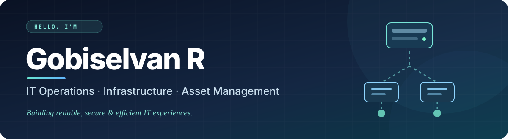

 

**IT Asset Management & System Engineer · IT Operations Professional · Vendor & Project Management**

📍 **Bengaluru, India** &nbsp; | &nbsp; 💼 **4+ years of experience** &nbsp; | &nbsp; ✉️ **Open to professional connections**

 

---

## 👨‍💻 A little about me

I'm an **IT operations and asset management professional** with **4+ years of experience** supporting people, systems, and business-critical technology.

My work spans **IT infrastructure, system administration, end-user support, asset lifecycle management, identity and access, vendor coordination, and security improvements**. I enjoy simplifying processes, keeping services dependable, and helping teams work without IT interruptions.

> **My approach:** Reliable infrastructure. Secure access. Smarter operations.

## ✨ What I bring to the table

| Focus | How I contribute |
| :--- | :--- |
| 🖥️ **IT Operations & Support** | End-user support, onboarding/offboarding, incident resolution, IT service delivery, and troubleshooting |
| 📦 **IT Asset & License Management** | Procurement coordination, inventory controls, asset lifecycle tracking, renewals, utilization, and compliance |
| 🌐 **Infrastructure & Systems** | Network connectivity, endpoint administration, cloud productivity tools, Wi-Fi, VPN, firewall planning, and infrastructure upgrades |
| 🔐 **Security & Governance** | Identity and access management, multi-factor authentication, security controls, policy improvements, and audit readiness |
| 🤝 **Vendors & Projects** | Stakeholder coordination, supplier relationships, service-level follow-ups, IT deployments, and cost optimization |
| ⚙️ **Automation & Improvement** | Reporting, process standardization, operational efficiency, and practical automation |

## 💼 Professional journey

| Organization | Focus |
| :--- | :--- |
| **Blitz (Blitznow)** | IT operations, infrastructure, workplace technology, asset management, and security initiatives |
| **Licious** | IT asset management, procurement, software licensing, vendor management, and operational improvement |
| **Sugar.fit** | System administration, user access management, infrastructure support, and employee IT support |
| **Graphene Associates** | Systems engineering, networking support, and technical troubleshooting |

## 🧰 Tools & technology

## 🎓 Learning & credentials

- **Claude 101** — AI Fundamentals & Productivity
- **Google Cloud Platform** — Fundamentals
- **Red Hat Enterprise Linux / AWS & DevOps** — Technical learning
- **Cisco CCNA** — Routing & Switching

## 🤝 Let's connect

I'm interested in **IT infrastructure, asset management, service improvement, and secure workplace technology**. Always happy to exchange ideas with fellow IT professionals.

📨 **Email:** [gobiselvan.r@outlook.in](mailto:gobiselvan.r@outlook.in)  
📸 **Instagram:** [@mr_rgs.13](https://www.instagram.com/mr_rgs.13/)  
🌍 **Based in:** Bengaluru, Karnataka, India

---

  <em>Build better systems · Support people · Keep improving</em>

